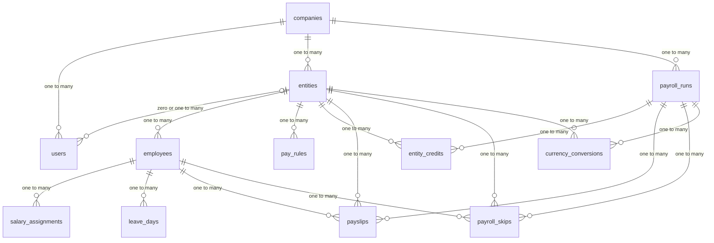

# Salary Manager — Backend architecture

Product requirements live in the frontend repository: [docs/requirements](https://github.com/yuvarajuv27/salary_manager_frontend/tree/main/docs/requirements). This document is the server design for that release. Screens, routes, and client libraries are in the [frontend architecture](../../../salary_manager_frontend_local/docs/architecture/salary-manager.md).

Each Get started creates a company. A signed-in user sees only that company.

## Context and goals

Admin and HR record employees and pay rules for legal entities in nine countries. On the company’s payroll day the API credits a payslip per eligible employee, stores it, and returns analytics in the entity currency and in the company’s primary currency. Employees never sign in. The API stores bank details for a later payout and does not send money.

## Ownership

The Rails API owns records, money, authorization, and the payroll clock. PostgreSQL is the system of record. Solid Queue is the clock: an hourly UTC scheduler enqueues each due company as a batch of retried jobs. A wake after downtime enqueues any company month whose payroll instant has passed and is not finished. The React app sends the rules on the screen, including unsaved edits, and the typed gross. Rails answers the preview and the real run with the same calculator. The app does not calculate money and does not decide who may see an entity.

Sign-in is an HttpOnly session cookie with `SameSite=Lax`. The cookie is not `SameSite=None`. The API is API-only today, so session and cookie middleware are added back for that cookie, and Rails forgery protection stays off. `SameSite=Lax` is what keeps a cross-site request from sending the cookie. In local development the Vite app and the API are different ports on `localhost`, which browsers treat as one site. A deployed app and API must stay on one site so that cookie is sent.

Authorization is a server rule. The session user’s company is the scope of every query. Admin covers that company and every entity in it. HR covers the one entity on the user. A record in another company is a 404.

## Gems

JSON responses use `render json:`. The only outbound HTTP call is Frankfurter, through HTTParty, behind a small client object tests can replace. Passwords use `has_secure_password`. Bank details use Active Record Encryption. Payroll dates are UTC dates. This design does not include a deploy tool, a host, or a process manager.

| Gem | Use |
|---|---|
| `rails` `~> 8.1.4` | API, Active Record, Active Job, encryption, cookie session |
| `pg` `~> 1.1` | PostgreSQL |
| `puma` | HTTP server |
| `bcrypt` | Password digests. Uncomment it in the Gemfile when sessions are built. It is commented out today. |
| `solid_queue` | Hourly scheduler, batches, and retried jobs |
| `rack-cors` | The Vite origin in local development |
| `httparty` | Frankfurter requests. Add it. |
| `bootsnap` | Boot cache |

Development and test:

| Gem | Use |
|---|---|
| `rspec-rails` | Unit and request specs. Add it. The app does not use RSpec yet. |
| `debug`, `bundler-audit`, `brakeman`, `rubocop-rails-omakase` | Already in the Gemfile |

`kamal`, `thruster`, `tzinfo-data`, `solid_cache`, `solid_cable`, and `image_processing` are in the Gemfile from the Rails app template. This release does not use them. There is no Devise, Pundit, Sidekiq, Redis, Jbuilder, Faraday, or Money gem.

`tzinfo-data` ships a copy of the timezone database for Windows and JRuby, which do not have the operating system's zoneinfo files. This product stores payroll as a UTC date and does not keep a company timezone. On macOS and Linux, Rails reads zoneinfo from the operating system, so the gem is not required.

## Modules

| Module | Job |
|---|---|
| Identity | Get started, onboarding, users, sessions |
| Organization | The company and its entities |
| Workforce | Employees, salary, revisions, leave, bank details |
| Rules | The rule list and the calculator |
| Payroll | The month’s payroll instant, the run, credited payslips, skipped rows |
| Currency conversion | The stored Frankfurter rate and the converted totals |
| Analytics | Reads closed payslips and conversions |

## Data model

The tables, keys, and relationships are in [Database](#database). Amounts are integer minor units. JPY uses exponent 0. The other eight currencies use exponent 2. A percent is a decimal greater than 0 and at most 100, with up to four decimal places (`numeric(7,4)`). Money columns are `bigint` and are zero or greater.

Each company is one row. Users, entities, and payroll runs store `company_id`. Employees, rules, leave, payslips, skips, and conversions belong to an entity, and the entity belongs to the company. Bank details are columns of the employee, stored as one encrypted document.

| Column | Meaning |
|---|---|
| `legal_name` | Company legal name |
| `primary_currency` | One of INR, USD, GBP, CAD, JPY, AUD, SGD, EUR |
| `payroll_day` | Integer 1–31. Default 31. The setting used when a future month is scheduled |
| `next_payroll_on` | The frozen payroll date for the open month |

A month’s payroll date is `payroll_day`, or that month’s last day when the day does not exist. Changing `payroll_day` leaves `next_payroll_on` as it is. When a run credits the calendar month of `next_payroll_on`, the following month’s `next_payroll_on` is computed from the current `payroll_day`. Get started stores the next date still in the future, so a passed date this month is never written and that month is never credited.

| Record | What it holds |
|---|---|
| User | Company, name, email, password digest (`has_secure_password`), access role `admin` or `hr`. HR has exactly one `entity_id` in that company. Admin has none. Email is unique across the installation, so sign-in finds one company. |
| Entity | Company, name, country, payout currency. Country and currency change only before the entity’s first credited payslip. That change replaces every employee’s bank details with a complete set for the new country, in the same transaction. |
| Employee | Name, `job_role`, `department`, one entity, inclusive `start_date`, optional inclusive `end_date` on or after the start, and a required encrypted bank document for the entity’s country. Job role and department are required, non-blank text. The entity never changes. |
| Salary assignment | Employee, `effective_on` (the first day of a month), and an amount of 0 or greater. Unique per employee and `effective_on`. The salary in force on a date is the latest assignment with `effective_on` on or before that date. No such row means the salary is unset. Unset is distinct from zero. |
| Leave day | Employee and a date, unique. Only a day inside the employment dates. A credited month for that employee rejects adds and removals. |
| Pay rule | Entity, name, position, side (`earning`, `employee_deduction`, or `employer_contribution`), kind (`percent` or `fixed`), amount, and an optional ceiling. An earning is a percent of gross, with no ceiling and no fixed amount. A deduction or employer percent may have a ceiling greater than 0. A fixed deduction or employer amount has no ceiling. |
| Payroll run | One per company per calendar month the scheduler has opened. Unique on the company and the month. Status `processing` or `credited`. Stores `payroll_on` and the primary currency in force when the run opened. |
| Entity credit | One per entity per run. Unique on the run and the entity. Status `processing` or `credited`. The entity’s month is closed when this row is `credited`. |
| Payslip | One per employee in that run who was employed on at least one day of the month and had a salary. Unique on the run and the employee. Stores payable days, leave days, days outside employment, the salary used, gross, net, and employer cost in the entity currency, plus a `jsonb` document of the rule lines. Those three day counts add up to the length of the month. When the saved earning percents sum to 100, that document includes each earning. Those earning amounts add up to gross. |
| Skip | One per employee employed on at least one day of the month with no salary. Stores the reason `monthly_salary_unset`. No payslip. |
| Conversion | One per entity per run. Rate, the date that rate was published, and converted gross, net, and employer cost in the run’s primary currency. Status `stored` or `pending`. Same currency stores rate 1 and the payroll date. A failed fetch stores `pending` and leaves the converted amounts empty. The rate is a decimal with scale 10. |

Payslips, skips, and the run are insert-only. Later edits to salary, leave, rules, bank details, job role, department, or the primary currency do not update them. Payslip screens read the employee’s current job role and department.

### Salary writes

The open month is the calendar month of `next_payroll_on`.

- A correction writes or replaces the assignment effective on the first day of the open month. It is rejected when that month is already credited. The run reads the salary in force on `next_payroll_on`.
- A revision writes or replaces the assignment effective on the first day of the next calendar month after the month in which it is saved. A second revision saved in that same calendar month replaces the pending one. A revision cannot be dated further out.
- The calendar month in which a revision is saved keeps the salary already in effect.
- When a correction and a revision both set the salary the open month will use, the later save is the one stored, and the run reads that amount.

A salary of 0 is a real salary and produces a payslip. An unset salary produces a skip when the person was employed on at least one day of the month.

## Database

Money is a `bigint` named `*_minor`. It stores the currency’s minor unit. JPY uses exponent 0, so a minor unit is one yen. The other currencies use exponent 2. The currency code lives on the company, the entity, or the payslip snapshot that owns the amount. A percent is `numeric(7,4)`. A Frankfurter rate is `numeric(20,10)`. Every table has `id bigint` primary key, `created_at`, and `updated_at`. Tenant rows also store `company_id`. A composite foreign key on `(company_id, parent_id)` keeps a row inside its company.

### Relationships

Each row is one foreign key. The child belongs to exactly one parent, except `users.entity_id`, which may be null.

| Parent | Child | Relation |
|---|---|---|
| `companies` | `users` | one to many |
| `companies` | `entities` | one to many |
| `companies` | `payroll_runs` | one to many |
| `entities` | `users` | zero or one to many |
| `entities` | `employees` | one to many |
| `entities` | `pay_rules` | one to many |
| `entities` | `entity_credits` | one to many |
| `entities` | `payslips` | one to many |
| `entities` | `payroll_skips` | one to many |
| `entities` | `currency_conversions` | one to many |
| `employees` | `salary_assignments` | one to many |
| `employees` | `leave_days` | one to many |
| `employees` | `payslips` | one to many |
| `employees` | `payroll_skips` | one to many |
| `payroll_runs` | `entity_credits` | one to many |
| `payroll_runs` | `payslips` | one to many |
| `payroll_runs` | `payroll_skips` | one to many |
| `payroll_runs` | `currency_conversions` | one to many |

An employee in one run has a payslip or a skip, or neither when they had no day in the month. The credit job writes only one of those two rows. Payslips and skips are insert-only. The rule lines are a document on the payslip, not a child table.

### Tables

`companies`

| Column | Type | Constraint |
|---|---|---|
| `legal_name` | `text` | not null |
| `primary_currency` | `text` | not null, one of INR, USD, GBP, CAD, JPY, AUD, SGD, EUR |
| `payroll_day` | `integer` | not null, default 31, check 1–31 |
| `next_payroll_on` | `date` | not null |

`users`

| Column | Type | Constraint |
|---|---|---|
| `company_id` | `bigint` | not null, foreign key to `companies` |
| `entity_id` | `bigint` | null, composite foreign key `(company_id, entity_id)` to `entities (company_id, id)` |
| `name` | `text` | not null |
| `email` | `text` | not null, unique |
| `password_digest` | `text` | not null |
| `access_role` | `text` | not null, `admin` or `hr` |

Check: `access_role = 'hr'` implies `entity_id` is present. `access_role = 'admin'` implies `entity_id` is null.

`entities` has a unique key `(company_id, id)` so that composite foreign key can be declared.

| Column | Type | Constraint |
|---|---|---|
| `company_id` | `bigint` | not null, foreign key to `companies` |
| `name` | `text` | not null |
| `country` | `text` | not null, one of the nine countries in FR-5 |
| `currency` | `text` | not null, the payout currency for that country |

`employees` has unique keys `(company_id, id)` and `(company_id, entity_id, id)`.

| Column | Type | Constraint |
|---|---|---|
| `company_id` | `bigint` | not null |
| `entity_id` | `bigint` | not null, composite foreign key `(company_id, entity_id)` to `entities (company_id, id)` |
| `name` | `text` | not null |
| `job_role` | `text` | not null |
| `department` | `text` | not null |
| `start_on` | `date` | not null |
| `end_on` | `date` | null, check `end_on >= start_on` |
| `bank_payload` | `text` | not null, Active Record Encryption. JSON for the country field set in FR-14. |

`salary_assignments`

| Column | Type | Constraint |
|---|---|---|
| `company_id` | `bigint` | not null |
| `employee_id` | `bigint` | not null, composite foreign key `(company_id, employee_id)` to `employees (company_id, id)` |
| `effective_on` | `date` | not null, the first day of a month |
| `amount_minor` | `bigint` | not null, check `>= 0` |

Unique `(employee_id, effective_on)`.

`leave_days`

| Column | Type | Constraint |
|---|---|---|
| `company_id` | `bigint` | not null |
| `employee_id` | `bigint` | not null, same composite foreign key as salary assignments |
| `leave_on` | `date` | not null |

Unique `(employee_id, leave_on)`.

`pay_rules`

| Column | Type | Constraint |
|---|---|---|
| `company_id` | `bigint` | not null |
| `entity_id` | `bigint` | not null, composite foreign key `(company_id, entity_id)` to `entities` |
| `name` | `text` | not null |
| `position` | `integer` | not null, check `>= 0` |
| `side` | `text` | not null, `earning`, `employee_deduction`, or `employer_contribution` |
| `kind` | `text` | not null, `percent` or `fixed` |
| `percent` | `numeric(7,4)` | null |
| `amount_minor` | `bigint` | null |
| `ceiling_minor` | `bigint` | null |

Check: a percent rule has `percent` in `(0, 100]`, null `amount_minor`, and a null ceiling or a ceiling greater than 0. A fixed rule has `amount_minor` greater than 0, and null `percent` and `ceiling_minor`. An earning rule is a percent rule with a null ceiling.

`payroll_runs` has a unique key `(company_id, id)`.

| Column | Type | Constraint |
|---|---|---|
| `company_id` | `bigint` | not null, foreign key to `companies` |
| `month_on` | `date` | not null, the first day of the credited month |
| `payroll_on` | `date` | not null |
| `primary_currency` | `text` | not null, the nine-currency set |
| `status` | `text` | not null, `processing` or `credited` |

Unique `(company_id, month_on)`.

`entity_credits`

| Column | Type | Constraint |
|---|---|---|
| `company_id` | `bigint` | not null |
| `payroll_run_id` | `bigint` | not null, composite foreign key `(company_id, payroll_run_id)` to `payroll_runs` |
| `entity_id` | `bigint` | not null, composite foreign key `(company_id, entity_id)` to `entities` |
| `status` | `text` | not null, `processing` or `credited` |

Unique `(payroll_run_id, entity_id)`.

`payslips`

| Column | Type | Constraint |
|---|---|---|
| `company_id` | `bigint` | not null |
| `payroll_run_id` | `bigint` | not null, composite foreign key to `payroll_runs` |
| `entity_id` | `bigint` | not null, composite foreign key to `entities` |
| `employee_id` | `bigint` | not null, composite foreign key `(company_id, entity_id, employee_id)` to `employees (company_id, entity_id, id)` |
| `currency` | `text` | not null |
| `payable_days` | `integer` | not null, check `>= 0` |
| `leave_days_count` | `integer` | not null, check `>= 0` |
| `outside_days` | `integer` | not null, check `>= 0` |
| `salary_minor` | `bigint` | not null, check `>= 0` |
| `gross_minor` | `bigint` | not null, check `>= 0` |
| `net_minor` | `bigint` | not null, check `>= 0` |
| `employer_cost_minor` | `bigint` | not null, check `>= 0` |
| `lines` | `jsonb` | not null, a JSON array. `[]` when the payslip has no rule lines. |

Unique `(payroll_run_id, employee_id)`.

Each object in `lines` has `position`, `name`, `side` (`earning`, `employee_deduction`, or `employer_contribution`), `kind` (`percent` or `fixed`), `percent` as text with four decimal places or null, `amount_minor` or null, `ceiling_minor` or null, and `computed_minor` as an integer zero or greater. `percent` is text so the scale stays exact. The calculator checks this shape before insert. An earning object has a percent, a null amount, and a null ceiling. When earning percents sum to 100, those objects are in the array and their `computed_minor` values add up to `gross_minor`. When they do not, the array has no earning objects.

`payroll_skips`

| Column | Type | Constraint |
|---|---|---|
| `company_id` | `bigint` | not null |
| `payroll_run_id` | `bigint` | not null, composite foreign key to `payroll_runs` |
| `entity_id` | `bigint` | not null, composite foreign key to `entities` |
| `employee_id` | `bigint` | not null, same employee composite foreign key as payslips |
| `reason` | `text` | not null, `monthly_salary_unset` |

Unique `(payroll_run_id, employee_id)`.

`currency_conversions`

| Column | Type | Constraint |
|---|---|---|
| `company_id` | `bigint` | not null |
| `payroll_run_id` | `bigint` | not null, composite foreign key to `payroll_runs` |
| `entity_id` | `bigint` | not null, composite foreign key to `entities` |
| `status` | `text` | not null, `stored` or `pending` |
| `rate` | `numeric(20,10)` | null until stored |
| `rate_on` | `date` | null until stored |
| `primary_currency` | `text` | not null |
| `gross_minor` | `bigint` | null until stored |
| `net_minor` | `bigint` | null until stored |
| `employer_cost_minor` | `bigint` | null until stored |

Unique `(payroll_run_id, entity_id)`. Check: `stored` requires rate, `rate_on`, and the three converted amounts. `pending` leaves those five columns null.

### Delete and restrict

| Action | Database result |
|---|---|
| Delete a company or a user | No application path in this release. Foreign keys restrict a company delete while users, entities, or runs exist. |
| Delete an entity | Allowed only when it has no payslip. Skip rows do not block the delete and are removed with the employees. The application first deletes that entity’s rules, employees, salary assignments, leave days, and skips. Bank details delete with the employee. A user still assigned to the entity blocks the delete. |
| Delete an employee | Allowed only when that employee has no payslip. Skip rows do not block the delete. Salary assignments, leave days, and that employee’s skips delete with the employee. |
| Delete a payroll run, payslip, skip, or conversion | No application path. These rows stay. The lines document stays on the payslip. |

## Calculator

One Ruby object serves the preview and the payroll run.

The preview receives the rules on the screen and a typed gross. It does not prorate and it does not write a payslip.

For a real run, gross is `salary * payable_days / days_in_month`, calculated with rational arithmetic and rounded once to the currency’s minor unit, half away from zero. A payable day is a calendar day inside the employment dates that is not leave. Weekends count. Days after the payroll day count. Leave outside employment is ignored.

Earning rules split that gross for the payslip. They are percents of the same gross. With none, the payslip has no earnings section. With some, their percents must sum to 100 or the preview returns 422 and the payroll run stores no earning lines. Deductions and employer contributions still run. When the percents sum to 100, each earning line is `gross * percent / 100`, rounded once, and the last earning line in list order is gross minus the earlier earning lines so the split equals gross.

Each deduction and employer rule then uses that same gross, in list order:

- A percent line uses the gross. When a ceiling is present, the base is the smaller of the gross and the ceiling. The line is `base * percent / 100`, rounded once the same way.
- A fixed line contributes its amount in full.

One line does not change the base of the next. An earning line is not a base for the next deduction. Net is the greater of zero and gross minus the employee deductions. Employer cost is gross plus the employer contributions. With no deduction or employer rules, net and employer cost equal the gross.

Worked example from FR-19: gross 10,000, an employee line at 10%, an employer line at 12% with a ceiling of 8,000, and an employee fixed amount of 500. The employee percent is 1,000. The employer line is 960. Net is 8,500. Employer cost is 10,960.

## Payroll run

The Solid Queue supervisor is the worker. It polls the queue database and runs jobs, including the hourly recurring task. Puma starts that supervisor in the same process when `SOLID_QUEUE_IN_PUMA` is set, which `config/puma.rb` already does. A separate `bin/jobs` process is the worker only when that variable is unset. Development does not set the Solid Queue adapter, so the clock runs there only after the adapter and a supervisor are on.

A Solid Queue recurring job runs every hour. For each company whose UTC time is on or after `next_payroll_on` at 00:00 UTC, and whose calendar month is not finished, the scheduler opens one payroll run for that company and enqueues the work. Companies are separate batches. It never enqueues a month whose date is still ahead, and it never enqueues the month that Get started skipped. A company with no entity is not scheduled. When its first entity is saved, a `next_payroll_on` that has already passed is moved to the next future payroll date, and the missed month is not credited.

The run is a Solid Queue batch:

1. The scheduler inserts the payroll run row, unique on the company and the month, with that company’s primary currency, and status `processing`.
2. It enqueues one entity-credit job per entity, in slices of 50, with `ActiveJob.perform_all_later` inside that batch.
3. Each entity-credit job writes that entity’s payslips, including each payslip’s lines document, and its skips. Employees are written in groups of 100. A payslip is unique on the run and the employee, and a skip is unique on the run and the employee, so a retry continues after the rows already stored.
4. When an entity-credit job commits, it enqueues one currency-conversion job for that entity.
5. The batch’s finish callback runs only after every entity-credit job has succeeded. It marks the run `credited` and sets the following month’s `next_payroll_on` from the current `payroll_day`.

An entity closes when its own credit job commits. From then on, salary and leave writes for that entity in that month are rejected, and rule edits leave those payslips unchanged. Another entity whose job has not succeeded yet stays open. The company month is finished only when the batch callback has run.

Each entity-credit job and each currency-conversion job uses `retry_on` for `StandardError`, 5 attempts, waiting polynomially longer between attempts. A discarded entity-credit job, after those attempts, leaves that entity uncredited and leaves the run in `processing`. The next hourly wake enqueues jobs only for entities that do not yet have a finished credit on that run. A second execution of a finished entity writes nothing new.

For every entity the credit job writes:

- a payslip for each employee employed on at least one day of the month who has a salary, including a zero-gross payslip when every employed day is leave
- a skip, with reason `monthly_salary_unset`, for each employee employed on at least one day of the month whose salary is unset. The payslip list says the monthly salary was not set
- no row for an employee with no day in the month
- no payslip for an entity with no employees, and still a finished credit so the batch can complete

Because an entity closes when its credit job commits, leave cannot be added afterward for the payroll day or for any later day in that month.

The currency-conversion job fetches Frankfurter once for that entity. The request is the rate on the original payroll date from `https://api.frankfurter.app`. When that date has no published rate, the stored rate is the previous published business day’s rate, and the stored date is that business day. Converted gross, net, and employer cost are the entity totals times the rate, each rounded once, half away from zero, to the primary currency’s minor unit. Matching currencies store rate 1 and do not call Frankfurter. A timeout or an error response retries. After the last attempt the conversion stays `pending` and the payslips stay in the entity currency. The hourly scheduler also enqueues conversion jobs for rows still `pending`, using each row’s original payroll date. The HTTParty client is injectable so tests can substitute a fake.

## API

An HR request for another entity, and any request for another company, is a 404, the same as a missing record. No session is 401. A failed validation is 422 with field errors and writes nothing. Amounts on the wire are minor units plus the currency code. The screens that call these routes are in the frontend architecture.

| Method and path | Who | Behavior |
|---|---|---|
| `POST /sign_up` | Public | Name, email, password, legal name, primary currency, and payroll day. Creates a company and its first Admin, sets `next_payroll_on` to the next future payroll date, and signs them in. An email already in use is 422. |
| `POST /session` | Public | Email and password. Sets the cookie for that user’s company. An unknown email or a wrong password is 401. |
| `DELETE /session` | Signed in | Clears the cookie. This is sign out. |
| `GET /session` | Signed in | Current user, including name, company id, access role, and entity id when HR. Includes whether the company has an entity yet. |
| `GET /company`, `PATCH /company` | Admin | Legal name, primary currency, payroll day. Patching `payroll_day` does not change `next_payroll_on`. |
| `GET /users`, `POST /users` | Admin | List and create inside the Admin’s company. Create body is name, email, password, access role, and entity id when the role is `hr`. The entity must belong to that company. |
| `GET /entities`, `POST /entities` | Admin for collection writes. HR `GET` returns their entity only. | Create takes name and country. Currency comes from the country. Rules start empty. |
| `GET /entities/:id`, `PATCH /entities/:id`, `DELETE /entities/:id` | Admin. HR may `GET` their entity. | Patch can rename. Country patch is Admin-only and only before the first credited payslip. It includes a new complete bank set for every existing employee. Delete is Admin-only and only when the entity has no payslip. Skip rows do not block it and are removed with the employees. It removes that entity’s rules, employees, salary assignments, leave days, and skips. |
| `GET/POST /entities/:id/pay_rules` | Admin or HR for that entity | Create and list. |
| `PATCH/DELETE /entities/:id/pay_rules/:rule_id` | Admin or HR for that entity | Edit and delete. |
| `PATCH /entities/:id/pay_rules/order` | Admin or HR for that entity | Reorder. |
| `POST /entities/:id/pay_rules/preview` | Admin or HR for that entity | Body is the rules on the screen and a gross in minor units of the entity currency. Returns earning lines when those percents sum to 100, plus deduction and employer lines, net, and employer cost. Earning percents that are present and do not sum to 100 are 422. Writes nothing. |
| `GET/POST /entities/:id/employees` | Admin or HR for that entity | List and create. Create requires a complete bank set for the entity’s country. List and show return the account holder name and masks. |
| `GET/PATCH/DELETE /entities/:id/employees/:employee_id` | Admin or HR for that entity | Show, edit, and delete. A bank edit replaces the whole set. Delete is rejected when any payslip exists. Skip rows are removed with the employee and do not block the delete. |
| `PUT .../salary` | Admin or HR for that entity | Correction for the open month. |
| `PUT .../salary_revision` | Admin or HR for that entity | Revision for the first of the next calendar month. |
| `GET/POST /entities/:id/employees/:employee_id/leave_days` | Admin or HR for that entity | List and add. The date must fall inside employment and in a month that is not credited for that employee. |
| `DELETE .../leave_days/:date` | Admin or HR for that entity | Remove. Same credited-month rule. |
| `GET /entities/:id/payroll_runs` | Admin or HR for that entity | Credited months. |
| `GET /entities/:id/payroll_runs/:month` | Admin or HR for that entity | Payslips and skips for that month. |
| `GET /entities/:id/payslips/:payslip_id` | Admin or HR for that entity | One payslip and its lines. |
| `GET /entities/:id/analytics` | Admin or HR for that entity | Entity analytics. |
| `GET /analytics` | Admin | Account analytics. |

### Bank details

`employees.bank_payload` stores only the fields for the entity’s country. The employee API returns the account holder name in full. Every other field is a mask of its last four characters, or fully masked when the value is shorter than four. The full value is never returned again, never placed on a payslip, and never included in analytics. Replacing the stored details means submitting a new complete set on the employee. When decryption fails, the employee response includes `"bank_details": { "readable": false }` and includes no secret field and no ciphertext. The rest of the employee still loads.

A country change that is still allowed updates the currency and replaces every employee’s bank document in the same transaction. The request supplies one complete set per existing employee for the new country. An employee left without a set refuses the change.

### Validation the API rejects

Blank rule name. Percent outside `(0, 100]`. Fixed amount or ceiling at or below zero. A ceiling on a fixed rule. An earning rule with a fixed amount or a ceiling. Earning percents on a preview that do not sum to 100. Salary below zero. Blank job role, department, or user name. End date before the start date. A missing or partial bank set. A duplicate email. An HR user with no entity, or an Admin with an entity. An entity id from another company. Leave outside employment. Leave added or removed in a credited month. A correction aimed at a credited month. A revision dated after the next calendar month. Deleting an employee who has a payslip. Deleting an entity that has a payslip. Changing country after the first credited payslip, or changing country without a new bank set for every existing employee.

## Analytics

Entity analytics are in the entity’s payout currency. Account analytics are in the primary currency stored on each run. Both read credited payslips and stored conversions. Neither calls Frankfurter.

The entity page shows the latest credited month: headcount, gross, net, and employer cost. Headcount is the number of payslips, including zero-gross payslips. Skip rows are left out of the headcount and out of the money. A line shows gross, net, and employer cost for the last 12 credited months, or fewer when fewer months exist. For the latest month, employee deductions and employer contributions are totaled by rule name and side by expanding each payslip’s `lines` document.

The account page shows the same headline numbers and the same 12-month line, summed from conversions whose status is `stored`. It also shows a bar of employer cost by entity for the latest credited month. An entity whose conversion for a month is pending is left out of that month’s totals, including headcount. On the latest month, those entities are listed by name. A credited month whose conversions are all pending still appears on the line with zero headcount and zero amounts. A month that already has a stored rate keeps it after the primary currency changes. Every entity on the run gets a conversion row, including an entity whose payslip totals are zero.

Before the first credited month, both pages say there is nothing to chart yet.

## Testing

RSpec covers the Rails behavior. Money math stays in Rails. Screen tests live in the frontend architecture.

RSpec unit examples cover the calculator, including the worked example above, proration, half-away-from-zero rounding, a JPY amount with exponent 0, a salary of 0, and an unset salary.

RSpec request examples cover who receives a payslip, the zero-gross leave case, a skip row, an employee with no day in the month, and an entity with no employees. They cover a closed entity staying unchanged, Get started skipping a payroll instant that has already passed, a payroll-day change leaving `next_payroll_on` in place, a short month using its last day, a wake after downtime enqueueing the open month once, and a second execution of a finished entity writing no extra payslip. They cover the scheduler enqueueing entity jobs in a batch, a failed entity job retrying and then continuing from payslips already stored, and the next month’s date advancing only after every entity credit has succeeded. Frankfurter examples use a fake HTTP client: matching currencies store rate 1, a missing payroll date stores the previous published business day, a failed fetch retries and then leaves the conversion pending, and a later wake fills that row for the original payroll date. Access examples cover two sign-ups creating two companies, a repeated email refused, an HR user receiving 404 for another entity, and an Admin receiving 404 for another company’s entity. Bank examples cover a full set stored as ciphertext on the employee, the mask, a missing or partial set rejected, a country change replacing each employee’s set, and an unreadable document returning `readable: false`. Analytics examples cover headcount including a zero-gross payslip, skip rows left out, and a pending entity left out of the account totals and listed by name.

## Risks and constraints

- A payroll day earlier than the last day of the month still counts the later days as payable, and leave cannot be marked on them after 00:00 UTC on the payroll day.
- Frankfurter being down leaves that entity’s conversion pending after the currency-conversion job has used its retries. Payslips in the entity currency are already final.
- Two workers can pick up the same month. The unique payroll month, the unique entity credit, and the unique payslip are what keep a retry from writing a second payslip. One entity can be closed while another entity’s job is still retrying.
- The session cookie is `SameSite=Lax` and requires the deployed frontend and API to be the same site. Passwords are stored only as digests. This release has no password-strength policy beyond a required password.
- Active Record Encryption keys must be configured before bank details can be saved.
- This release lists and creates users. It does not change or remove them. Invitation is the Admin setting a name, email, and password. There is no invitation email.
- Every company is a separate tenant. The session’s company id is applied on every read and write.
- Rules that depend on job role, department, or any other employee field are outside this release. So are payments, employee login, and the rest of the out-of-scope list in the requirements.
